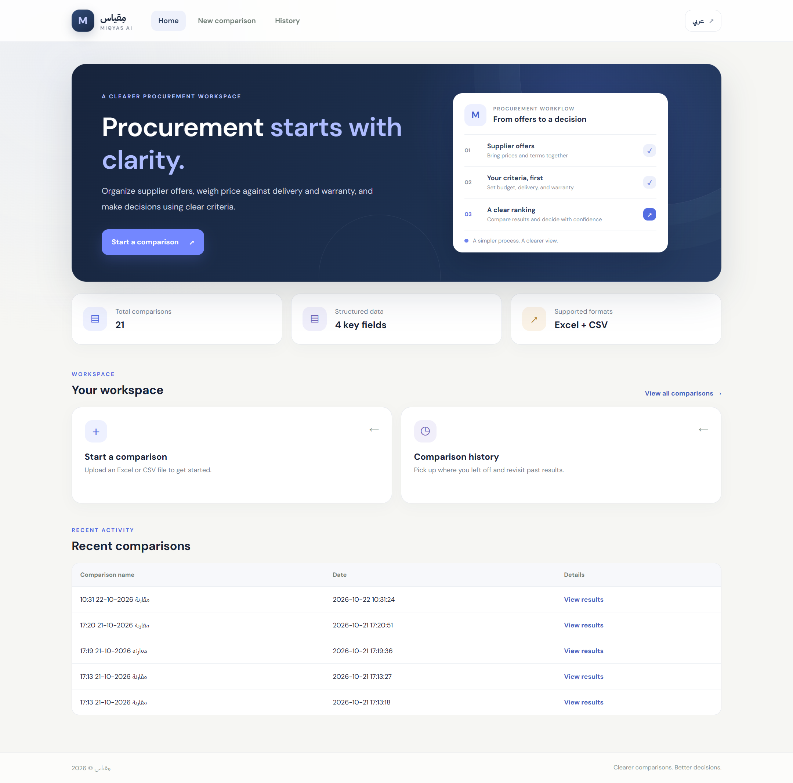
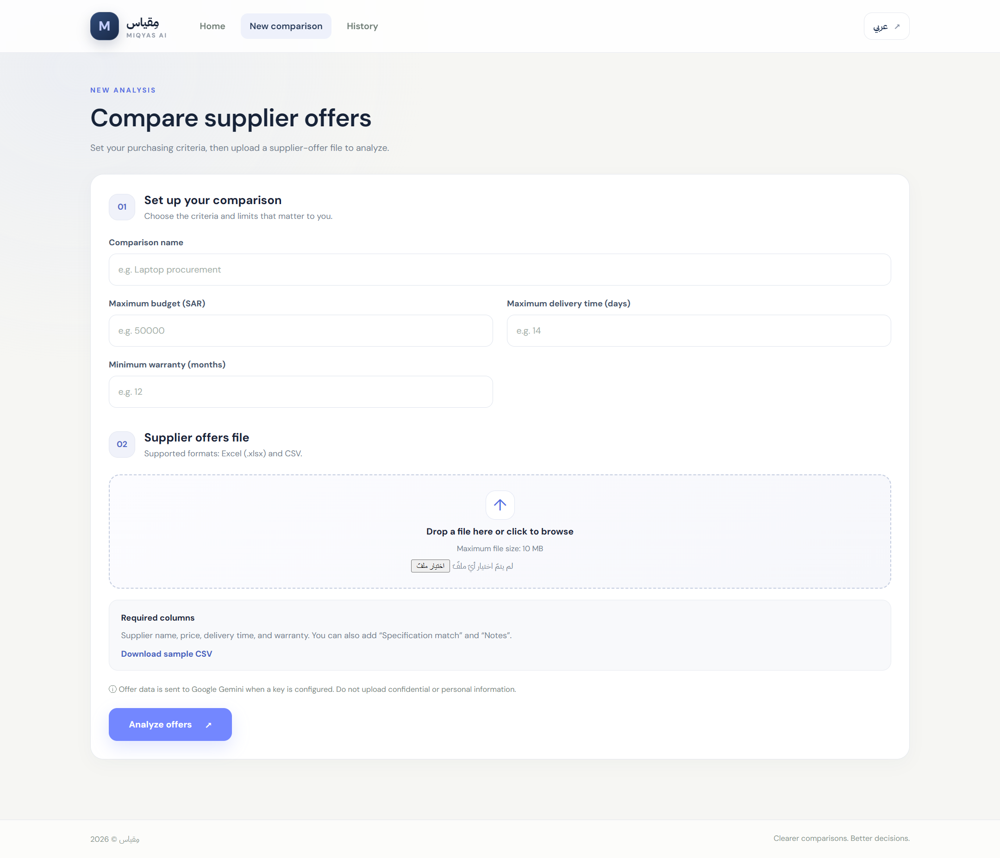
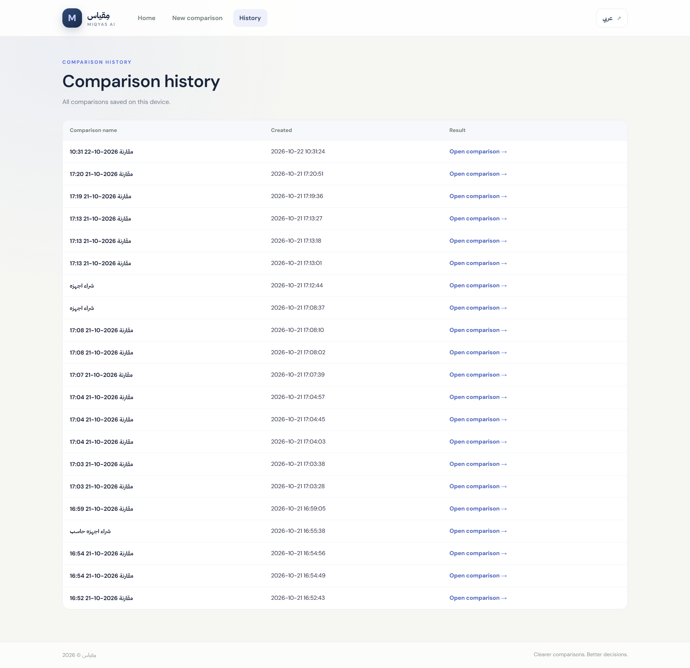

# Miqyas AI | مِقياس

**من عروض متعددة إلى قرار أوضح**

## نبذة عن المشروع

مِقياس هو تطبيق ويب يهدف إلى تسهيل مقارنة عروض الموردين وتنظيم بياناتها في مكان واحد. يساعد المستخدم على مراجعة الأسعار ومدد التسليم والضمانات، ومعرفة الفروقات بين العروض بطريقة واضحة تقلل الوقت والجهد المبذول في المقارنة اليدوية.

كما يتيح التطبيق رفع ملفات العروض وتحليل بياناتها، مع إمكانية الاستفادة من Google Gemini لتلخيص المعلومات عند تفعيل التكامل.

## أهداف المشروع

- تسهيل مقارنة عروض الموردين.
- تقليل الوقت المستغرق في مراجعة العروض يدويًا.
- تنظيم بيانات الموردين وتوحيد طريقة عرضها.
- توضيح الفروقات بين الأسعار ومدد التسليم والضمانات.
- دعم مراجعة الخيارات قبل اتخاذ قرار الشراء.

## مسار الأتمتة

1. **إدخال البيانات:** رفع ملفات عروض الموردين بصيغ CSV أو Excel.
2. **تنظيم المعلومات:** قراءة بيانات العروض وتجهيزها للمقارنة.
3. **مقارنة العروض:** تقييم الأسعار ومدد التسليم والضمانات وفق المعايير المحددة.
4. **عرض النتائج:** توضيح الفروقات بين العروض وإظهار البيانات الناقصة والملاحظات.
5. **المراجعة النهائية:** التحقق من النتائج قبل اتخاذ قرار الشراء.

## المميزات

- رفع ملفات CSV وExcel.
- مقارنة الأسعار ومدد التسليم والضمانات.
- عرض نتائج المقارنة بطريقة منظمة.
- إظهار الملاحظات والبيانات الناقصة.
- دعم اللغتين العربية والإنجليزية.
- إمكانية استخدام Google Gemini لتلخيص المعلومات عند تفعيل التكامل.
- تخزين البيانات باستخدام SQLite.

## التقنيات المستخدمة

- **Python** — معالجة البيانات وتنفيذ منطق التطبيق.
- **Flask** — بناء تطبيق الويب.
- **HTML** — بناء صفحات الواجهة.
- **CSS** — تنسيق الواجهة.
- **JavaScript** — إضافة التفاعلات.
- **SQLite** — تخزين البيانات.
- **Google Gemini API** — تلخيص المعلومات عند تفعيل التكامل.

## ملاحظات

- نتائج المقارنة تحتاج إلى مراجعة قبل اتخاذ قرار الشراء.
- يجب التأكد من صحة البيانات واكتمالها.
- يجب عدم مشاركة البيانات السرية مع الخدمات الخارجية دون تصريح.
- المشروع نسخة أولية قابلة للتطوير والتحسين.

**Miqyas AI | مِقياس**  
*من عروض متعددة إلى قرار أوضح.*

## العرض التقديمي | Presentation

[مشاهدة العرض التقديمي في المتصفح | View presentation online](https://view.officeapps.live.com/op/view.aspx?src=https%3A%2F%2Fraw.githubusercontent.com%2Fasma948y8%2FMiqyas-AI%2Fmain%2FMiqyas-AI%2FMiqyas_AI_presentation.pptx)

## لقطات من التطبيق | Screenshots

### الصفحة الرئيسية | Home

### مقارنة جديدة | New comparison

### سجل المقارنات | Comparison history

